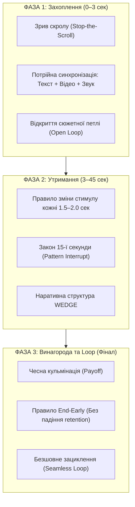

# Енциклопедія та Архітектура Залучення й Утримання Уваги в Контенті (2025–2026)
> **Статус документа:** Практичний довідник, нейробіологічна база та інженерний фреймворк для авторів, продюсерів і сценаристів.  
> **Формати охоплення:** Короткі відео (Shorts, Reels, TikTok), довгі формати (YouTube Long-form, подкасти) та текстовий копірайтинг (LinkedIn, X, розсилки, блоги).

---

## 1. Фундаментальна Нейробіологія: Чому Мозок Зупиняє Скрол

У сучасному цифровому середовищі мозок користувача перебуває в стані хронічного сенсорного перенасичення і працює в енергозберігаючому трансі (**Default Mode Network** — мережа пасивного режиму). Рішення про свайп приймається підсвідомо за **0.4–1.2 секунди**. Щоб перевести увагу у фокусований режим, контент має активувати конкретні еволюційні центри мозку.

```
[ Стрічка / Скрол ] 
       │
       ▼
⚡ Зрив патерну (Контраст / Аномалія) 
       │
       ▼
🧠 Ретикулярна активуюча система (RAS) 
       │
       ▼
🎯 Орієнтувальний рефлекс («Що це таке?») 
       │
       ▼
🕳️ Когнітивна прогалина (Information Gap) 
       │
       ▼
🔁 Дофамінова петля очікування нагороди (Reward Prediction Error)
```

### 1.1. Ретикулярна активуюча система (RAS) та орієнтувальний рефлекс
* **Принцип дії:** RAS фільтрує до 99% сенсорного шуму і пропускає у свідомість лише три типи сигналів: **загрозу**, **аномалію/новизну** або **потенційний ресурс/нагороду**.
* **Орієнтувальний рефлекс І. Павлова («Що це таке?»):** Будь-який різкий контраст (візуальний, раптовий звук, порушення звичного порядку) автоматично розгортає органи чуття до джерела зміни до ввімкнення раціонального мислення.

### 1.2. Теорія інформаційного дефіциту (Information Gap Theory Джорджа Ловенштейна)
* Цікавість активується не тоді, коли людина нічого не знає, а тоді, коли виникає **відчутний розрив** між тим, що їй уже відомо, і тим, що необхідно для цілісного розуміння.
* Мозок сприймає інформаційну порожнечу як свербіж або фізичний дискомфорт. Єдиний спосіб зняти цю напругу — додивитися або дочитати матеріал до закриття прогалини.

### 1.3. Ефект Зейгарнік та «Cognitive Incompletion»
* Мозок утримує незавершені процеси та відкриті сюжетні лінії (**Open Loops**) у фокусі робочої пам'яті в 2–3 рази довше, ніж завершені завдання.
* **Фундаментальна теза:** Гачок (Hook) — це не «розвага», це **стан когнітивної незавершеності**. Поки відкриту петлю не закрито, глядач психологічно прив'язаний до контенту.

### 1.4. Неприйняття втрат (Loss Aversion, Д. Канеман та А. Тверські)
* Страх припуститися помилки, втратити ресурси або відчути власну некомпетентність мобілізує увагу в **2.5 раза сильніше**, ніж прагнення здобути вигоду.
* *«3 помилки, які щодня спалюють ваш бюджет»* завжди перевершує за відгуком *«3 поради, як заощадити кошти»*.

### 1.5. Дзеркальні нейрони та емпатичний відгук
* Кадри з вираженою людською мімікою (шок, страх, гнів, напруга, щирий сміх) активують дзеркальні нейрони глядача менш ніж за 200 мс, створюючи миттєву ідентифікацію з автором або героєм відео.

---

## 2. Алгоритмічні Реалії та Математичні Бенчмарки (2025–2026)

У сучасних рекомендаційних системах (YouTube, TikTok, Meta) відбувся перехід від «дешевого клікбейту» до комплексних показників задоволеності.

### 2.1. Ключові метрики успіху
* **VVSA (Viewed vs Swiped Away):**
  * `< 60% VVSA` — алгоритмічна смерть (відео зупиняється на першій когорті переглядів: 400–2,400).
  * `70% – 75% VVSA` — прохідний мінімум для виходу на ширшу аудиторію.
  * `80% – 90%+ VVSA` — зелена зона для вірусного масштабування.
* **APVD (Average Percentage Viewed) та AVD (Average View Duration):**
  * Для коротких відео до 20 секунд потрібен показник APVD **> 100–120%** (завдяки повторним переглядам).
  * Для відео 50–60 секунд достатньо APVD **> 80–85%**, але абсолютний час перегляду (**AVD > 45-50с**) дає алгоритму в 4–5 разів більше цінного watch time, ніж коротке 10-секундне відео зі 100% додивлянням.
* **Velocity of Shares (Швидкість репостів):** Найпотужніший множник алгоритмічного бусту для виходу з вузької ніші в глобальні рекомендації.

---

## 3. Трифазна Модель Утримання Уваги



---

## 4. Фаза 1: Інженерія Гачка (0–3 Секунди)

Головна функція гачка — **зламати автоматизм скролу**.

### 4.1. Правило потрійної синхронізації (Triple Hook Rule)
1. **Візуальний ряд:** Дієвий, контрастний кадр або рух на рівні кадру 0. Жодних заставок, логотипів чи мовчазного кліпання очима.
2. **Текстовий гачок (On-Screen Text):** Контрастна текстова плашка по центру екрана. **Понад 70%** користувачів починають перегляд без звуку. Текст повинен зчитуватися за 0.5–1 секунду.
3. **Звуковий гачок:** Голос розпочинається з мілісекунди `00:00:00` без пауз і вдихів, супроводжуючись характерним SFX (*Whoosh, Snap, Click*).

---

## 5. Фаза 2: Retention Engineering (3–45 Секунд)

### 5.1. Закон стимуляції 1.5–2.0 секунд (Pacing Law)
* `< 1.2 с` на зміну кадру — перевантаження, мозок втомлюється від візуальної каші.
* `> 2.5 с` статичного кадру (одна «говоряча голова») — дофаміновий спад, глядач свайпає.
* **Оптимум (1.5 – 2.0 с):**
  * Масштабування (Punch-in / Punch-out на 10–15%).
  * Перебивка B-roll або предметний план.
  * Текстова плашка / кінетична типографіка.
  * Звуковий акцент на наголошених складах.

### 5.2. Закон 15-ї секунди (The 15-Second Disruption Law — Jenny Hoyos / MrBeast)
На 14–15 секунді первинний імпульс цікавості вичерпується. Обов'язковий **зрив патерну (Pattern Interrupt)**:
* Зміна темпу або вимикання фонової музики.
* Несподіваний поворот або ускладнення сюжету (*«Але раптом сталося те, чого ніхто не чекав...»*).
* Різка зміна ракурсу камери, колірної гами або перехід у нову локацію.

### 5.3. Наративна модель WEDGE (25–50 секунд)
* **W (Wedge / Клин, 0–3с):** Гостре твердження, питання або шокуюча візуальна аномалія.
* **E (Escalation / Ескалація, 3–15с):** Швидкий рух до вирішення з виявленням перешкоди.
* **D (Dilemma / Твіст, 15–25с):** Несподіване ускладнення чи зміна правил гри.
* **G (Gold / Кульмінація, 25–45с):** Справжня, чесна розв'язка обіцянки гачка.
* **E (End-Early, фінал):** Миттєвий обрив на кульмінаційному слові.

---

## 6. Фаза 3: Винагорода, Дія та Нескінченні Цикли

### 6.1. Правило «End-Early» (Усунення плато виходу)
* До 80% глядачів кидають відео в останні 3–5 секунд через шаблонні фрази-маркери закінчення: *«Підсумовуючи...», «Дякую за увагу...», «Підписуйтесь на канал...»*.
* **Інженерне рішення:** Відео закінчується жорстким катом рівно на піковому слові розв'язки. Нуль секунд на прощання.

### 6.2. Безшовне нескінченне зациклення (Seamless Loop для APVD > 100%)
* **Граматичний цикл:** Фінал відео синтаксично і за змістом переходить у перше речення:
  * *Кінець відео:* `«...і саме через це вам більше ніколи не доведеться шукати...»`
  * *Початок відео (00:00:00):* `«...як створювати вірусні відео з утриманням понад сто відсотків!»`
* **Візуальний Match-Cut:** Ідентичне положення голови, рук, напрямок руху та освітлення між останнім кадром $T_{end}$ і першим кадром $T_0$.

### 6.3. Фонове програвання через коментарі (Comment Section Friction)
* Коли користувач відкриває блок коментарів, відео продовжує грати у фоновому циклі, генеруючи 150–250% утримання.
* **Стимулятори коментарів:**
  * *Аномалія фону (Background Oddity):* Незвична деталь на задньому плані, про яку автор нічого не говорить (глядачі йдуть у коментарі писати: *«Хтось ще помітив кота на шафі?»*).
  * *Поляризуюче бінарне запитання:* Дилема, де кожен відчуває потребу висловити власну точку зору.

### 6.4. Прихована інформація та мікропаузи (Micro-Reading)
* Виведення цінної шпаргалки, рецепта, коду чи порівняльної таблиці на екран усього на **0.3–0.5 секунди**.
* Фраза: *«Поставте на паузу, щоб зберегти налаштування...»*.
* Глядач кілька разів тапає екран, промахується, повертає повзунок назад, генеруючи повторні мікро-перегляди на таймкоді.

---

## 7. Каталог Перевірених Формул Гачків

### 7.1. Семантичні формули (Копірайтинг)
| № | Тип гачка | Формула / Шаблон | Приклад |
| :--- | :--- | :--- | :--- |
| **1** | **The Contrarian Take** | *«Все, що вам говорили про [X] — повна брехня...»* | *«Все, що вам розповідали про ранній підйом о 5 ранку — міф, який вбиває продуктивність...»* |
| **2** | **Mistake Callout** | *«Припиніть робити [X] ось так, ви щодня втрачаєте [Y]...»* | *«Припиніть нарізати цибулю ось так, ви буквально випалюєте собі очі...»* |
| **3** | **The Insider Secret** | *«Те, про що мовчать 99% експертів у [галузі]...»* | *«Що автомеханік помічає в машині за перші 3 секунди огляду...»* |
| **4** | **The Time Challenge** | *«Чи можливо [досягти складної мети] до того, як [проста дія]? Таймер пішов...»* | *«Чи можна зібрати сайт з нуля, поки заварюється кава? Перевіряємо...»* |
| **5** | **The Paradox Question** | *«Чому [несподівана категорія людей] категорично відмовляється від [звичайна річ]?»* | *«Чому пілоти цивільних літаків ніколи не п'ють бортову воду?»* |
| **6** | **The Relatable Reality** | *«Те саме огидне відчуття, коли [типова життєва ситуація]...»* | *«Те відчуття, коли чуєш перший звук будильника в понеділок вранці...»* |
| **7** | **Direct Value Promise** | *«3 приховані функції в [інструмент], які заощадять вам 2 години на день...»* | *«3 налаштування батареї в iPhone, які подвоюють її життя за 30 секунд...»* |
| **8** | **The Shocking Stat** | *«[X]% людей роблять цю фатальну помилку щодня...»* | *«91% стартапів закриваються не через брак грошей, а через ось це одне слово...»* |

### 7.2. Візуальні формули
* **In Media Res:** Відкриття з епіцентру дії (розбита тарілка, летить інструмент, розпал конфлікту), без нудного розгону.
* **0.3s Tease (Результат уперед):** Фінальний результат показується на частку секунди: *«Ось що вийшло, а ось з якого безладу я починав...»*.
* **Visual Anomaly / Pattern Break:** Перевернутий ракурс камери, агресивний колірний фільтр або нестандартний аспект кадру.

---

## 8. Технічні Параметри та Звукова Архітектура

### 8.1. Карта безпечних зон вертикального формату (1080 × 1920)
```
┌────────────────────────────────────────┐ 0 px
│      ВЕРХНЯ МЕРТВА ЗОНА (250 px)       │ Пошук, вкладки, системні іконки
├────────────────────────────────────────┤ 250 px
│                                        │
│                                        │
│          БЕЗПЕЧНА АРЕНА ДЛЯ            │
│          СУБТИТРІВ ТА ГРАФІКИ          │
│       [X: 100-900, Y: 300-1500]        │
│                                        │
│                                        │
├────────────────────────────────────────┤ 1500 px
│      НИЖНЯ МЕРТВА ЗОНА (420 px)        │ Аватар, нікнейм, опис, аудіо
└────────────────────────────────────────┘ 1920 px
```

### 8.2. Чотиришаровий аудіо-дизайн
1. **Голос (Voiceover):** Моно-канал, агресивний компресор, порізані всі паузи й вдихи, нормалізація до **-14 LUFS** (true peak -1.0 dB).
2. **Музична підкладка (BGM):** Рівень **-18...-24 dB** щодо голосу з обов'язковим **sidechain auto-ducking** (-3...-5 dB, коли звучить голос).
3. **Transition Foley:** Звуки швидкого повітря (*Whoosh, Swoosh*) під час зміни планів.
4. **Anchor SFX:** Механічні кліки (*Pop, Click*) на появі тексту, напружений райзер (*Riser*) перед 15-ю секундою і потужний саб-бас (*Sub-bass Drop*) на кульмінації.

---

## 9. Адаптація Під Інші Формати

### 9.1. YouTube Long-form (Великі відео та подкасти)
* **Синергія Прев'ю (Thumbnail) та Заголовка (Title):** Thumbnail створює відкриту петлю і показує конфлікт або емоцію. Title розкриває суть. Перші 20 секунд відео зобов'язані підтвердити обіцянку обкладинки, інакше відсоток відмов досягає 50–60%.
* **Мікро-арки (Micro-Climaxes):** Довге відео ділиться на 2–3-хвилинні фрагменти. Кожен блок будується як самостійна міні-історія: міні-гачок → наростання інтриги → вирішення → перехід до наступного блоку через J-cut/L-cut.

### 9.2. Текстовий копірайтинг (LinkedIn, X, статті, розсилки)
* **Ковзанка Шугермана (The Greased Chute):** Єдина мета першого речення — змусити прочитати друге. Мета другого — змусити прочитати третє.
* **Bucket Brigades (Містки уваги):** Короткі фрази для перенесення погляду:
  * *«Але ось у чому парадокс:»*
  * *«І тут почалося найцікавіше...»*
  * *«Звучить складно? Насправді все навпаки.»*
* **Візуальне дихання (Whitespace):** Абзаци не довші за 1–2 речення. Порожній простір знижує когнітивне навантаження і стимулює швидке сканування.

---

## 10. Еволюція Алгоритмів (2025–2026): Hook-Payoff Alignment

* **Штраф за клікбейт:** Якщо гачок дає завищену обіцянку, а відео не дає прямої та якісної відповіді, алгоритм фіксує миттєвий свайп, дизлайк або скаргу «Не цікавить». Це веде до песимізації показів усього каналу.
* **Принцип симетрії:** Гачок обіцяє **100% цінності**, а контент видає **120%**. Перевищення очікувань — головний драйвер підписок та репостів.

---

## 11. Контрольний Чек-лист Перед Публікацією

- [ ] **Кадр 0 (Frame Zero):** Вирізано всі мікропаузи, вдихи, логотипи та порожні погляди до першого слова/руху.
- [ ] **Німий перегляд:** Чи є на екрані контрастний заголовок у безпечній зоні в перші 1.5 секунди?
- [ ] **Ритм стимуляції:** Чи змінюється масштаб, план або графіка кожні 1.5–2.0 секунди?
- [ ] **Злам патерну на 15-й секунді:** Чи присутній твіст, ускладнення або зміна аудіо-темпу на 14–15 секунді?
- [ ] **Відсутність повільного виходу (End-Early):** Чи обрізано всі фрази прощання та заклики до підписки у фіналі?
- [ ] **Безшовне зациклення:** Чи стикується кінцівка ролика з його початком?
- [ ] **Закриття петлі (Payoff):** Чи отримав глядач вичерпну та чесну відповідь на інтригу гачка?
